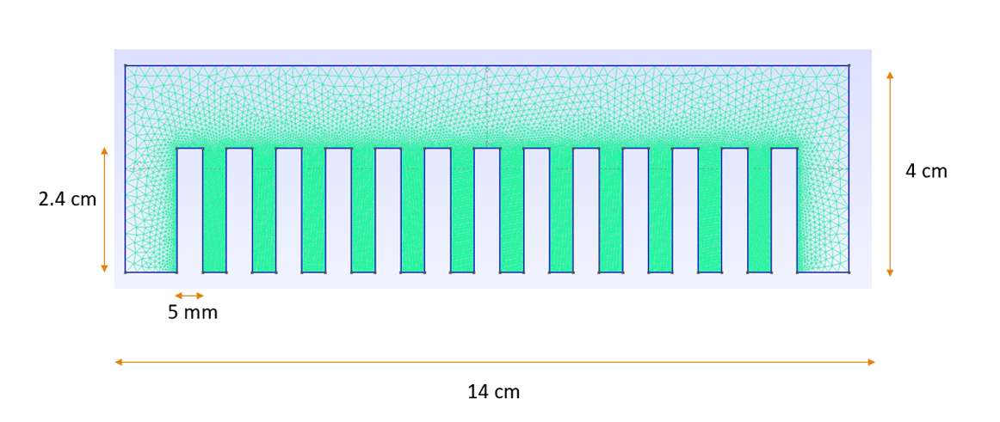

# CFD-Driven Design Validation & Optimization of Heat Sinks

### Computational Fluid Dynamics | Thermal Management | Design Optimization

**University of Colorado Boulder | MCEN 4231/5231 – Computational Fluid Dynamics**

---

## Project Overview

This project investigates the optimization of passive heat sink fin arrays using Computational Fluid Dynamics (CFD) to improve natural convection heat transfer.

Three fin configurations were evaluated to determine the optimal balance between heat transfer surface area, fin spacing, and buoyancy-driven airflow.

The study identified a **10-fin configuration with 9.3 mm spacing** as the optimal design, achieving significantly higher heat dissipation than the alternative configurations.

  

  <em>Heat sink geometry and CFD temperature distribution — Click to enlarge</em>

  

---

## Engineering Highlights

| Parameter | Result |
|---|---|
| Configurations Evaluated | 3 |
| Optimal Configuration | 10 Fins |
| Optimal Fin Spacing | 9.3 mm |
| Maximum Heat Transfer Rate | 4.62 W |
| Improvement over 6-Fin Design | 62% |
| Improvement over 13-Fin Design | 18% |
| Cooling Mechanism | Natural Convection |

---

## Project Objectives

- Optimize fin spacing for maximum natural convection heat transfer.
- Evaluate the influence of fin density on thermal performance.
- Analyze thermal boundary layer interaction and airflow restriction.
- Compare heat transfer rates across multiple configurations.
- Investigate buoyancy-driven flow using finite element-based CFD.

---

## Simulation Configurations

Three heat sink configurations were analyzed while maintaining identical base dimensions.

| Configuration | Number of Fins | Fin Spacing | Heat Transfer Rate |
|---|---:|---:|---:|
| A | 6 | 17.8 mm | 2.85 W |
| B | **10** | **9.3 mm** | **4.62 W** |
| C | 13 | 6.5 mm | 3.92 W |

  <em>Comparison of heat sink configurations</em>

<table>
  <tr>
    <td align="center" width="33%">
      
       
      <b>6-Fin Configuration</b>
       
      17.8 mm spacing
    </td>
    <td align="center" width="33%">
      
       
      <b>10-Fin Configuration</b>
       
      9.3 mm spacing — Optimal
    </td>
    <td align="center" width="33%">
      
       
      <b>13-Fin Configuration</b>
       
      6.5 mm spacing
    </td>
  </tr>
</table>

---

## CFD Methodology

### Governing Physics

The simulations modeled transient, buoyancy-driven natural convection using:

- Conservation of mass
- Momentum conservation
- Energy conservation
- Boussinesq approximation for buoyancy effects

### Numerical Approach

| Method | Implementation |
|---|---|
| Discretization | Finite Element Method (FEM) |
| Coupling Strategy | Monolithic Velocity-Pressure-Temperature Coupling |
| Temporal Discretization | Crank–Nicolson |
| Stabilization | SUPG & PSPG |
| Nonlinear Solver | Newton Solver |
| Linear Solver | GMRES |
| Preconditioner | LU |
| Parallel Processing | MPI |

---

## Computational Setup

| Parameter | Value |
|---|---|
| Computational Domain | 14 cm × 4 cm |
| Fin Height | 2.4 cm |
| Fin Thickness | 5 mm |
| Mesh Type | Unstructured Triangular |
| Mesh Elements | 45,000–75,000 |
| Simulation Duration | 5 seconds |
| Time Step | 0.0275 s |
| Prandtl Number | 0.7215 |
| Rayleigh Number | 5.69 × 10⁸ |

  

  <em>Computational domain and heat sink geometry</em>

---

## Meshing Strategy

Unstructured triangular meshes were generated using Gmsh, with local refinement near fin surfaces to capture thermal and velocity gradients.

- Near-fin mesh size: **0.3 mm**
- Outer-domain mesh size: **2.5 mm**
- Total mesh elements: **45,000–75,000**

<table>
  <tr>
    <td align="center" width="50%">
      
       
      <b>Computational Mesh</b>
    </td>
    <td align="center" width="50%">
      
       
      <b>Near-Fin Mesh Refinement</b>
    </td>
  </tr>
</table>

---

## Boundary & Initial Conditions

| Boundary / Parameter | Condition |
|---|---|
| Bottom Surface & Fins | No-Slip, Constant Temperature |
| Side Boundaries | Open Boundary |
| Top Boundary | Open Boundary |
| Initial Fluid Velocity | Stationary |
| Ambient Temperature | 303 K |
| Fin Temperature | 353 K |

  

  <em>Boundary conditions for buoyancy-driven natural convection</em>

---

## Simulation Results

### Temperature Distribution

Temperature fields were evaluated to investigate heat dissipation, thermal boundary layer development, and temperature distribution between adjacent fins.

  
  <b>10 Fins</b>

  <em>Final Results of the 10 Fin Heat-Sink</em>

---

## Key Results & Engineering Insights

### Optimal Fin Configuration

The **10-fin configuration** achieved the highest heat transfer rate of **4.62 W**, outperforming both alternative configurations.

- **62% higher heat transfer** than the 6-fin configuration.
- **18% higher heat transfer** than the 13-fin configuration.
- Optimal balance between available heat transfer surface area and natural convection airflow.

### Thermal Boundary Layer Interaction

| Configuration | Engineering Observation |
|---|---|
| 6 Fins | Larger spacing supports airflow but provides less heat transfer surface area. |
| 10 Fins | Balances surface area and airflow, achieving the highest heat dissipation. |
| 13 Fins | Reduced spacing increases boundary layer interaction and restricts airflow. |

The results demonstrate that increasing fin count does not necessarily improve natural convection performance. Excessively narrow fin spacing can reduce heat transfer by restricting airflow and increasing thermal boundary layer interaction.

The study identified an optimal spacing-based Rayleigh number range of approximately **Raₛ = 10³–3 × 10³**.

---

## Tools & Engineering Methods

| Category | Tools / Methods |
|---|---|
| CFD & Numerical Simulation | DOLFINx, FEniCS |
| Meshing | Gmsh |
| Parallel Computing | MPI |
| Post-Processing | Temperature & Velocity Field Visualization |
| Thermal Analysis | Natural Convection, Heat Transfer |
| Numerical Methods | FEM, SUPG, PSPG, Crank–Nicolson |

---

## Project Outcomes

- Identified an optimal passive heat sink configuration through CFD-based design comparison.
- Demonstrated a **62% improvement in heat transfer** over the 6-fin baseline.
- Evaluated thermal boundary layer interaction and buoyancy-driven airflow.
- Applied monolithic finite element coupling to natural convection simulations.
- Established design insights applicable to passive thermal management systems.

### Engineering Applications

- Electronics and semiconductor cooling
- Automotive electronics thermal management
- Aerospace thermal systems
- Passive heat sink design
- Thermal management of compact electronic assemblies

---

## Project Report

The complete project report contains the governing equations, numerical methodology, computational setup, simulation results, and detailed engineering analysis.

  

---

## Project Team

**University of Colorado Boulder**

- Surya Sharon Raj Goda
- Saravana Kumar Kodakinti Prakash
- Anoop Subramanya
- K. Vaikunth Keshav

---

## Contact

**Anoop Subramanya**

Mechanical Engineer | CFD | Thermal Systems | Mechanical Design

- LinkedIn: www.linkedin.com/in/anoopsubramanya
- Email: anoopms2001@gmail.com

---

  <b>Engineering better thermal solutions through simulation-driven design.</b>

